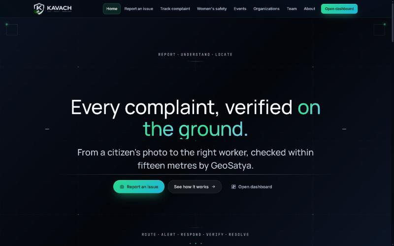
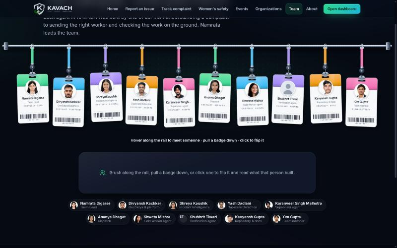
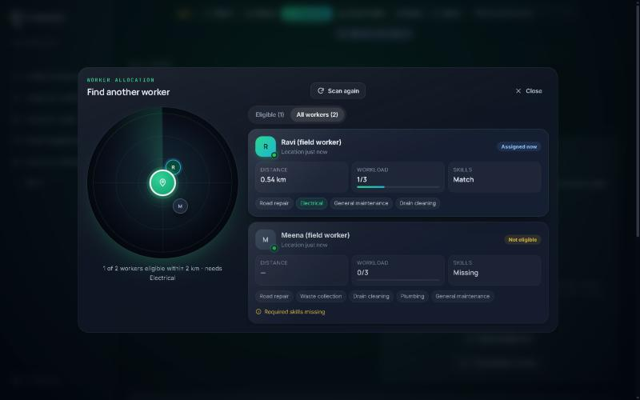
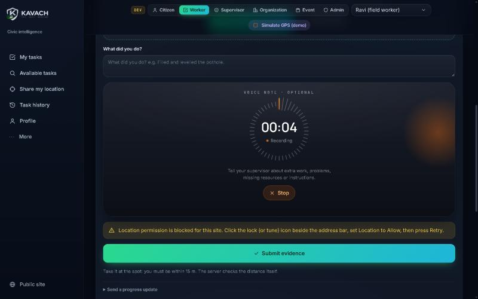
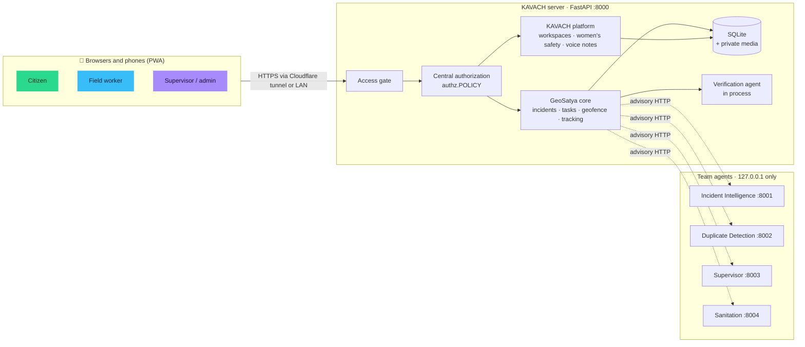

<div align="center">


### Every complaint, verified on the ground.

**KAVACH** is a civic intelligence and public-safety platform: a citizen reports a problem with a photo and real GPS,
team AI agents understand it, the nearest qualified field worker is dispatched and tracked live, and the repair only
counts once **GeoSatya** proves the worker was within 15 metres of the complaint and a supervisor approves it.

<br>


<br>


<br>


[Overview](#-overview) · [Features](#-key-features) · [Architecture](#-architecture) · [Quick start](#-quick-start) · [Configuration](#-configuration) · [API](#-api) · [Testing](#-testing) · [Roadmap](#-roadmap) · [Ownership](#-ownership--team)

</div>

---

## ✦ Overview

Complaint handling for sanitation and public incidents is slow, workers are hard to hold accountable, and nobody can
prove a repair really happened at the reported spot. KAVACH closes that loop end to end:

```
 Report ──▶ Understand ──▶ Locate ──▶ Route ──▶ Alert ──▶ Respond ──▶ Verify ──▶ Resolve ──▶ Learn
 photo+GPS   AI agents     GeoSatya   dispatch   worker    live map   15 m geo-  supervisor  public
                           checks     ranking    notified  + ETA      fence      approval    dashboard
```

**Design principle:** AI suggests and describes; deterministic rules and people decide. No language model ever has the
final say on priority, assignment, approval or pass/fail, and a phone's coordinates are evidence, never proof.

<div align="center">

| Landing | Team wall |
|:---:|:---:|
|  |  |
| **Worker allocation radar** | **Voice note on job completion** |
|  |  |

</div>

---

## ✦ Key features

| Area | What it does |
|---|---|
| 📸 **Camera-first reporting** | Complaints need a photo taken with the camera and the phone's GPS read at the same moment. Gallery files and dropped pins are refused; the server rates every report `LOCATION_VERIFIED` or `NEEDS_REVIEW` (accuracy, freshness, photo time vs GPS time, EXIF comparison). |
| 🛰️ **GeoSatya verification** | A completion only counts if its photo and GPS are within the **15 m geofence** of the complaint, with acceptable accuracy. Simulated locations are always labelled and never pass as real. |
| 🧭 **Intelligent dispatch** | Workers are filtered by availability, skills, capacity and a location under 15 minutes old within the dispatch radius, then ranked 70% distance / 30% workload (optionally by road ETA via OSRM). Automatic, with manual assign / reassign / release. |
| 📡 **Worker search radar** | Supervisors scan for workers on a glass radar: each worker appears at their real bearing and distance from the incident, with rank, workload, skills and why someone is not eligible. Read-only: it never assigns by itself. |
| 🗺️ **Live operations** | Supervisor live map, citizen tracking screen with ETA and estimated time to resolve, journey sharing only while a job is active. |
| 🧑‍🔧 **Offline-ready worker app** | Installable PWA. Tasks stay readable offline; accept, arrive, progress and completion are queued and sent in order with idempotency keys. |
| 🎙️ **Voice notes** | Optional voice notes on an SOS (allies can play them from their private link while it is active) and on a job completion (the supervisor hears them during review). Real audio only, private storage, audited. |
| 🛡️ **Women's safety** | Trusted allies with consent, hold-to-trigger SOS with a cancel countdown, live phone GPS while active, private per-ally links, one-tap 100 / 108 / 112. |
| 🏢 **Workspaces** | Open civic platform plus organization and event workspaces (departments, zones, invites), each isolated from the others. |
| 🔐 **Sign-in and authorization** | JWT sign-in (citizens register; workers need a worker access code; supervisors and admins need an account plus their code). One central policy table authorizes every route and denies by default. |
| 🤝 **Team agents** | Incident Intelligence, Duplicate Detection, Supervisor and Sanitation Planning run as HTTP services; Verification runs in process. All advisory. |
| 📊 **Public transparency** | Public dashboard with aggregated figures and a public tracking page for any complaint reference. |

---

## ✦ Architecture



The frontend and API share one origin, so there is no CORS setup and no hard-coded server address. Agents listen on
`127.0.0.1` only; only the KAVACH server is ever exposed, and only through the tunnel or your network.

### Project structure

```
Kavach-epam-team/
├── run-kavach.ps1                 # start agents + server (+ Cloudflare link), verify everything, print the link
├── stop-kavach.ps1                # stop every KAVACH process (never touches anything else)
├── KAVACH_DEMO_GUIDE.md           # step-by-step live demo with phones
├── docs/screenshots/              # README images
└── services/
    ├── geosatya/                  # the KAVACH server (GeoSatya core + KAVACH platform)
    │   ├── geosatya/
    │   │   ├── main.py            # app factory, startup checks, routers, static frontend
    │   │   ├── config.py          # every setting, read from environment variables
    │   │   ├── authz.py           # central authorization: one row per route, deny by default
    │   │   ├── security.py        # password hashing (scrypt) and JWT tokens
    │   │   ├── api/               # GeoSatya routes, sign-in routes, dependencies, views
    │   │   ├── services/          # incidents, tasks, dispatch, tracking, verification logic
    │   │   ├── dispatch/          # the Dispatch agent's ranking rules
    │   │   ├── location/          # geofence, accuracy and EXIF checks
    │   │   ├── kavach/            # workspaces, public portal, women's safety, voice notes, team demo
    │   │   └── integrations/      # clients for the team agents
    │   ├── frontend/              # the web app: index.html, aurora.css design system, js/ modules
    │   ├── scripts/               # kavach_accounts.py (create supervisors/admins), icon generators
    │   ├── tests/                 # 320 automated tests
    │   ├── KAVACH_HANDOFF.md      # detailed engineering checkpoint, round by round
    │   └── README.md              # GeoSatya deep dive: workflows, geofence logic, full API table
    └── agents/                    # team agents, each an unmodified copy of its branch (see ORIGIN.md)
        ├── incident-intelligence/ ├── duplicate-detection/ ├── supervisor/
        ├── sanitation/            ├── verification/        └── start-agents.ps1
```

---

## ✦ Quick start

> Windows + PowerShell, Python 3.13. The scripts look for the server's Python in `services/geosatya/.venv`
> (or set `KAVACH_PYTHON` to any `python.exe`), and for the agents' Python in `services/agents/.venv`.

**1. Server environment (once)**

```powershell
cd services\geosatya
py -3.13 -m venv .venv
.\.venv\Scripts\python -m pip install -r requirements.txt
```

**2. Agents environment (once)**

```powershell
cd ..\agents
py -3.13 -m venv .venv
.\.venv\Scripts\python -m pip install fastapi "uvicorn[standard]" pydantic pydantic-settings httpx python-multipart python-dotenv pillow tzdata google-genai scikit-learn numpy sqlalchemy alembic
```

**3. Optional: a public HTTPS link for phones**

```powershell
winget install --id Cloudflare.cloudflared
```

**4. Run**

| Command (from the repository root) | What you get |
|---|---|
| `powershell -ExecutionPolicy Bypass -File .\run-kavach.ps1` | Development access: no login, role chips at the top (Citizen, Worker, Supervisor, Organization, Event, Admin) |
| `... .\run-kavach.ps1 -TeamDemo` | Team live demo: its own database with the ten team members and a simple sign-in (password `kavach123`) |
| `... .\run-kavach.ps1 -RealLogin` | Real JWT sign-in with worker / supervisor / admin access codes |
| add `-NoTunnel` | Laptop / LAN only, no Cloudflare link |
| `powershell -ExecutionPolicy Bypass -File .\stop-kavach.ps1` | Stop everything |

`run-kavach.ps1` checks every port first (it never stops a process that is not KAVACH), starts the four agents and the
server, checks that each one answers, starts the tunnel, **tests the link from outside**, and only then prints the link
and a random access code. Nothing secret is written to disk; codes and the token secret are new on every run.

Open **http://127.0.0.1:8000** on the laptop, or the printed `trycloudflare.com` link on any phone.

<details>
<summary><b>Run the server by hand (no scripts)</b></summary>

```powershell
cd services\geosatya
copy .env.example .env          # then edit: AUTH_MODE=demo for development
.\.venv\Scripts\python -m uvicorn geosatya.main:create_app --factory --host 127.0.0.1 --port 8000
```

Interactive API docs: http://127.0.0.1:8000/docs. The agents are optional; without them the server falls back to
safe defaults (for example NORMAL priority) and says so on screen.
</details>

---

## ✦ Configuration

All settings come from environment variables (or `services/geosatya/.env`; start from `.env.example`). The most
important ones:

| Variable | Default | Purpose |
|---|---|---|
| `AUTH_MODE` | `jwt` | `jwt` real sign-in · `demo` development identities (refused when `APP_ENV=production`) · `token` |
| `APP_ENV` | `development` | `production` enforces a strong `JWT_SECRET` and forbids demo modes |
| `JWT_SECRET` / `JWT_TTL_HOURS` | random in dev / `12` | token signing key (32+ characters in production) and lifetime |
| `WORKER_ACCESS_CODE` / `SUPERVISOR_ACCESS_CODE` / `ADMIN_ACCESS_CODE` | empty | sign-in codes, validated on the server only (6+ characters) |
| `ACCESS_CODE` | empty | optional gate in front of the whole site (used for tunnel links) |
| `TEAM_DEMO` | `false` | ten team accounts and a sign-in that accepts any password (needs `AUTH_MODE=demo`) |
| `DATABASE_URL` / `STORAGE_DIR` | `data/geosatya_v3.db` / `private_uploads/` | database and private photo / audio storage |
| `GEOFENCE_RADIUS_M` / `MAX_ACCURACY_M` | `15` / per settings | completion geofence and GPS accuracy limit |
| `DISPATCH_MAX_RADIUS_KM` / `DISPATCH_LOCATION_MAX_AGE_S` | `2` / `900` | dispatch radius and location freshness |
| `INTELLIGENCE_URL`, `DUPLICATE_DETECTION_URL`, `SUPERVISOR_AGENT_URL`, `SANITATION_AGENT_URL` | empty | team agents (set by `run-kavach.ps1`) |
| `ROUTING_URL` | empty | optional OSRM server for road routes and road ETA |
| `KAVACH_PORT`, `INTELLIGENCE_PORT`, `DUPLICATE_PORT`, `SUPERVISOR_PORT`, `SANITATION_PORT` | `8000`–`8004` | ports used by the scripts |

> Never commit `.env`, databases or uploads. They are git-ignored; `.env.example` contains placeholders only.

---

## ✦ API

Everything is under `/api/v1` (plus `/health`). **105 routes**, every one listed in the central policy
(`services/geosatya/geosatya/authz.py`). A wrong role gets `403`; another person's record gets `404`. Full reference with
request shapes: the running server's **`/docs`**, and the GeoSatya table in [`services/geosatya/README.md`](services/geosatya/README.md#15-api-endpoints).

| Group | Highlights | Who |
|---|---|---|
| **Sign-in** `/auth/*` | `POST /auth/citizen/register` · `POST /auth/worker/register` · `POST /auth/login` · `POST /auth/supervisor/login` · `GET /auth/me` · `POST /auth/logout` | public / signed in |
| **Reporting** | `POST /kavach/public/reports` (multipart: payload + camera photo) · `GET /kavach/incidents/{id}/check` · `GET /kavach/public/track/{ref}` · `GET /kavach/public/stats` | citizen / public |
| **Incidents** `/incidents/*` | detail, tracking, intelligence retry, dispatch retry, assign, **`GET /incidents/{id}/dispatch/candidates`** (worker search, read-only) | role-filtered / supervisor |
| **Tasks** `/tasks/*` | accept · decline · start · location · arrive · progress · completion · reassign · release · **audio-notes** | assigned worker / supervisor |
| **Workers** `/workers/*` | worker list · own profile · check-in (availability + one location) | supervisor / worker |
| **Review** | `GET /verification-queue` · `GET /completions/{id}` · `POST /completions/{id}/review` · `GET /evidence-history` | supervisor |
| **Live** | `GET /dashboard/live` · `GET /dispatch/board` | supervisor |
| **Workspaces** `/kavach/*` | organizations, events, departments, zones, invites, members, insights, platform admin | per workspace role |
| **Women's safety** `/women/*` | allies · `POST /women/sos` · location · cancel / resolve · **audio-notes** · `GET /women/share/{token}` (ally link) | citizen / token link |

---

## ✦ How it works

1. **Report.** The citizen picks a category and the camera opens. The photo, the GPS fix and both timestamps go to the server, which runs the GeoSatya report check.
2. **Understand.** Incident Intelligence structures the complaint and sets a priority; Duplicate Detection flags repeats; the Supervisor and Sanitation agents suggest a department and a plan. Every suggestion is advisory.
3. **Route and alert.** Dispatch picks the best eligible worker in the incident's workspace and creates exactly one task (idempotent; a retry never creates a second one).
4. **Respond.** The worker accepts, shares their journey while travelling, confirms arrival, starts work and can post progress notes; the citizen sees ETA and estimated time to resolve.
5. **Verify.** The completion photo is checked against the 15 m geofence and accuracy limit, the Verification agent reviews image quality, and the worker can add a voice note.
6. **Resolve and learn.** A supervisor approves, rejects or asks for more evidence; every decision is audited, and resolved work feeds the public dashboard.

---

## ✦ Testing

```powershell
cd services\geosatya
.\.venv\Scripts\python -m pytest -q
```

**320 tests** cover reporting and photo/GPS rules, the geofence, dispatch and the worker search, tracking and ETA,
offline idempotency, sign-in and the authorization policy (a route missing from the policy fails the suite),
workspaces, women's safety, voice notes, the team agents' adapters and the team live demo. No test needs a GPS device,
a browser, an API key or a database server.

---

## ✦ Security and privacy

- Authorization on the server for every route; hiding a button is only a convenience.
- Passwords hashed with scrypt; HS256 JWTs checked against the database on every request; sign-out revokes all devices.
- Access codes and secrets only in environment variables, compared in constant time.
- Photos and voice notes in private storage, served only through authorized routes; file types checked from their bytes.
- Worker location is shared only while a job is active and visible only to the people who need it.
- Demo and team-demo modes are refused in production.

---

## ✦ Roadmap

- [ ] SMS / WhatsApp / push delivery for SOS alerts (today the citizen sends each ally's link from their own phone).
- [ ] Background SOS tracking when the phone is locked (needs a native app or push-based wake).
- [ ] OTP and password reset; HttpOnly cookie sessions with CSRF protection instead of `localStorage` tokens.
- [ ] PostgreSQL + Alembic migrations for multi-server deployments.
- [ ] Field Worker agent (PostgreSQL) and zone-aware dispatch.
- [ ] A real contact address in the site footer (currently `hello@kavach.example`).

---

## ✦ Contributing

1. Branch from `main` (`feature/<short-name>`); never commit to `main` directly.
2. Keep the rule: **AI suggests, rules and people decide.** New routes must be added to `authz.POLICY` or the tests fail.
3. Run `python -m pytest -q` in `services/geosatya` before opening a pull request, and describe what you tested.
4. Never commit `.env`, databases, uploads or access codes.
5. Team agents under `services/agents/` are copies of their authors' branches: change them on the original branch, then refresh the copy.

---

## ✦ Ownership & team

<div align="center">

**KAVACH platform, GeoSatya verification, dispatch integration, live tracking, sign-in and authorization,
women's safety, voice notes and the web app: engineered and maintained by Divyansh Kackker.**

Built with **Team Codyssey**: *"AI-Driven Intelligence for Smarter Incident Resolution"*

</div>

| Member | Role in the project |
|---|---|
| **Namrata Digarse** | Team Lead · Sanitation Planning agent |
| **Divyansh Kackker** | KAVACH platform and GeoSatya: verification, dispatch, tracking, security, web app |
| **Shreya Kaushik** | Incident Intelligence agent |
| **Yash Dadlani** | Duplicate Detection agent |
| **Karanveer Singh Malhotra** | Supervisor agent |
| **Shubhrit Tiwari** | Verification agent |
| **Ananya Dhagat** | Dispatch work · repository owner |
| **Shweta Mishra** | Field Worker agent |
| **Kavyansh Gupta** | Repository setup and documentation |
| **Om Gupta** | Team member |

Each agent's original author and source branch are recorded in its `services/agents/<agent>/ORIGIN.md`.

<div align="center">
<sub>KAVACH does not replace the police, ambulance or emergency services. In danger, call <b>112</b>.
KAVACH is an independent project and is not endorsed by any government body. Maps © OpenStreetMap contributors.</sub>
</div>
